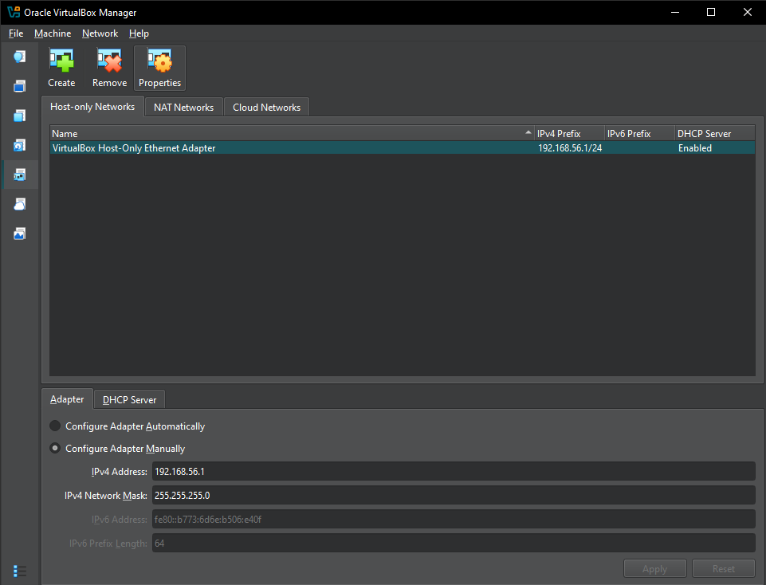
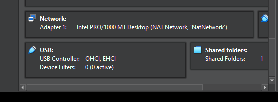
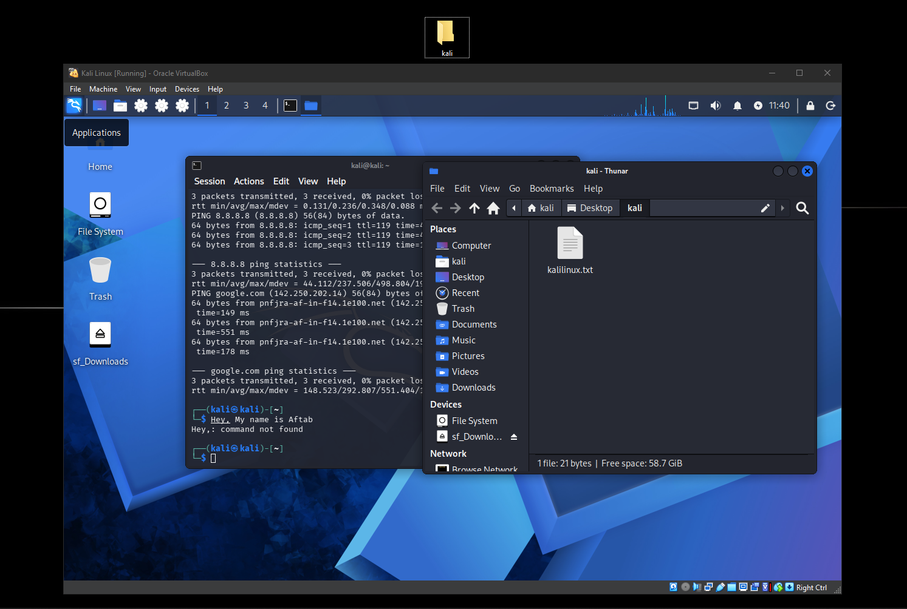
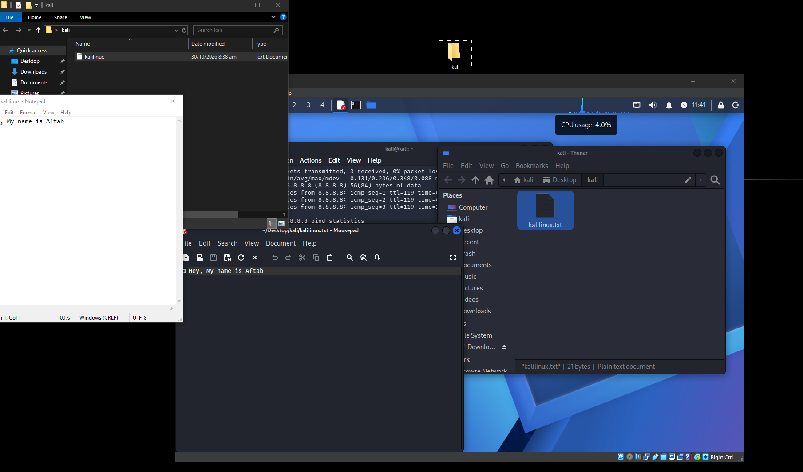
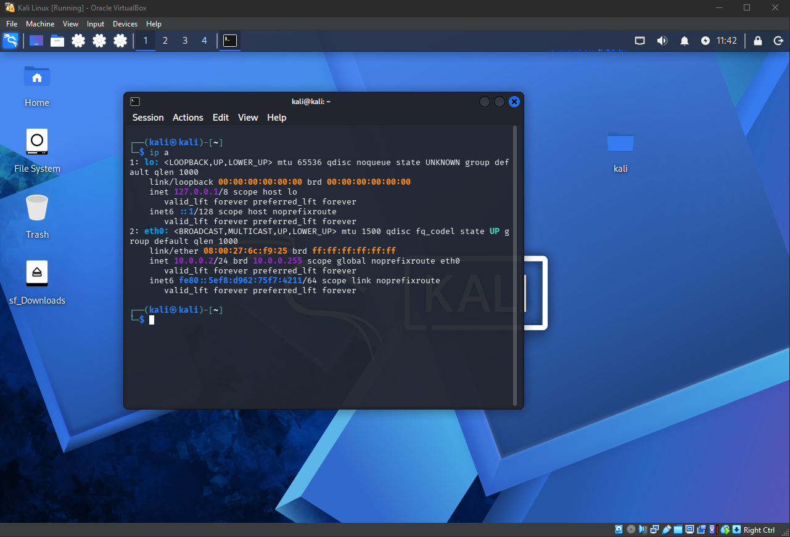
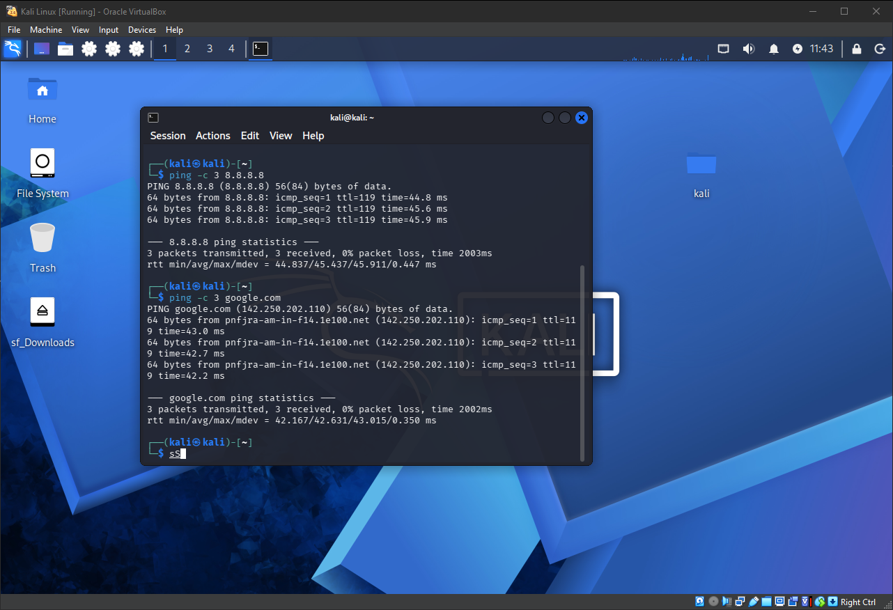
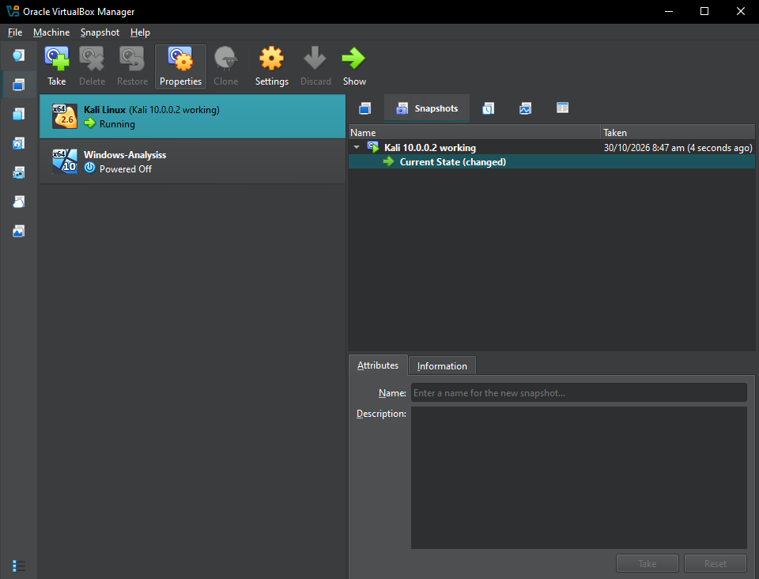

# NETWORKWALKS-EMMANUEL-B083-WK1-PM1-CYBERSECURITY-LAB-SETUP
Cybersecurity lab setup: VirtualBox + Kali Linux on an isolated NAT Network (10.0.0.0/24) for ethical hacking practice. Networkwalks Week 1 project.

# Cybersecurity Lab Environment Setup

Building an isolated virtual lab for penetration testing and ethical hacking practice.

## Project Overview
This project sets up a virtual cybersecurity lab using VirtualBox and Kali Linux. The lab is a controlled environment where security tools can be practiced safely on my own systems. It runs on a private virtual network so more machines can be added later.

## Lab Requirements
- VirtualBox (version: X.X.X)
- Kali Linux (version: 2026.2)
- Network: NAT Network 10.0.0.0/24
- Kali IP: 10.0.0.2/24
- Host PC: (RAM, storage, processor)

## Steps Completed

### Step 1: Installed 7-Zip and VirtualBox
(What you installed, and the versions)

### Step 2: Created the NAT Network
Created `NatNetwork` with prefix 10.0.0.0/24 and DHCP enabled.

### Step 3: Imported Kali Linux
(Downloaded the VirtualBox image, extracted it, imported it)

### Step 4: Configured the VM
- Network adapter set to NAT Network (NatNetwork), promiscuous mode Allow All

- Shared folder: host Downloads folder, auto-mount enabled

- Shared Clipboard and Drag'n'Drop set to Bidirectional

### Step 5: Set the static IP
Method Manual, address 10.0.0.2, netmask 24, gateway 10.0.0.1, DNS 8.8.8.8.

### Step 6: Tested connectivity
Pinged the gateway, 8.8.8.8 and google.com with 0% packet loss.

### Step 7: Took a snapshot

## Troubleshooting
**Problem:** After setting the static IP, the network icon kept loading and Kali had no connection.
**Solution:** Ran these commands, then reconnected:
sudo nmcli connection modify "Wired connection 1" ipv4.dad-timeout 0
sudo nmcli connection down "Wired connection 1"
sudo nmcli connection up "Wired connection 1"

## What I Learned
(2 to 4 sentences in your own words: NAT Network vs Bridged, static IPs, snapshots, why a lab is safe)

## Disclaimer
This lab is for education only. All testing is done inside my own virtual lab.
